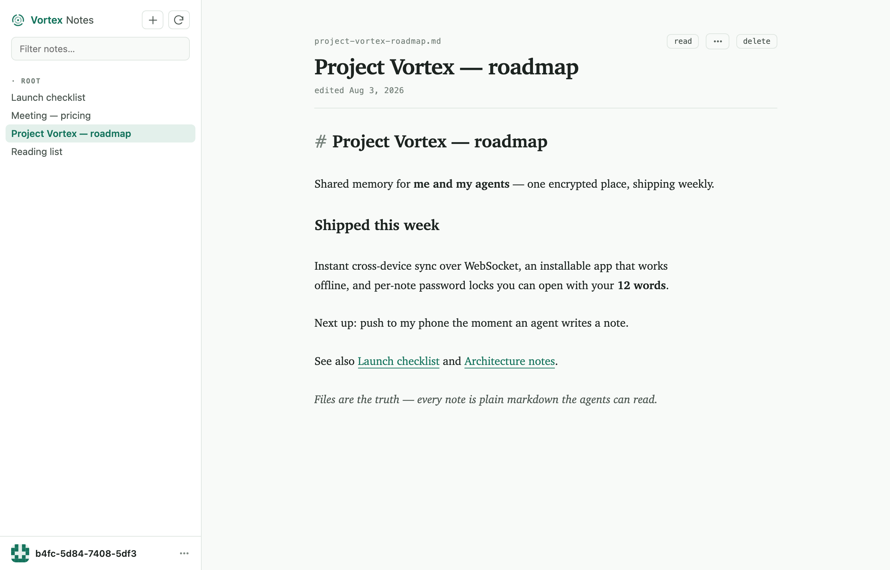
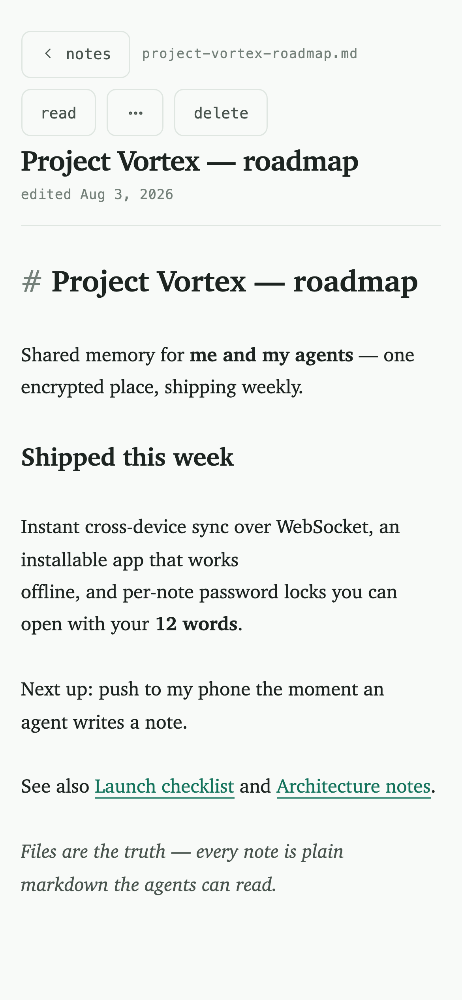
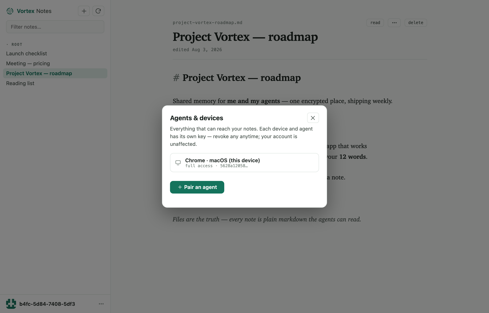

# Vortex Notes

**End-to-end-encrypted notes that double as memory for your AI agents.**

<p align="center">
  <a href="https://vortex-notes.pages.dev/app"><b>▶ Open the app</b></a> ·
  <a href="https://vortex-notes.pages.dev">Live demo</a> ·
  <a href="https://www.npmjs.com/package/vortex-notes">npm</a> ·
  <a href="#self-host-the-relay">Self-host</a>
</p>

<p align="center"></p>

Your notes are plain `.md` files you own — greppable, git-able, Obsidian-compatible.
Vortex Notes adds the two things a notes app and an agent-memory store each do
separately, in one place:

- **The server can't read anything.** A 12-word phrase is your whole account; keys
  are derived in your browser. The relay stores ciphertext only — no plaintext
  field exists in its schema, and there's no password to reset because there's
  nothing on the server to reset.
- **Agents are principals, not passengers.** An agent gets its *own* key — born on
  its machine, never transmitted, certified by yours, scoped to the spaces you
  grant, and revocable in one command. Every edit it makes is signed as the agent.

That combination — *agents can fully use it* **and** *the server can't read it* —
is the empty quadrant this fills.

---

## The app

A real app, not a viewer: **installable** on iPhone / Android / Mac (works
offline), **sub-second cross-device sync** over WebSocket, and an Obsidian-style
**live-preview** markdown editor that's as good on a phone as on a desktop.

<p align="center">
  
  &nbsp;&nbsp;
  
</p>

- **Password-locked notes** — lock a note with a password *or* your 12 words; the
  title stays visible, the body is a sealed second layer even your own devices
  can't read until unlocked.
- **Version history & recovery** — every synced version is kept; restore an earlier
  one, or recover a note whose password you lost from before it was locked.
- **Public notes** — publish any note to a themed public page in one tap.
- **Change your 12 words** — rotate your recovery phrase without losing a thing;
  every signed-in device and agent keeps working, the old phrase goes dead.

## Agent memory (MCP)

A first-party MCP server gives Claude Code, OpenClaw, Cursor, or any MCP client
task-shaped tools — not a CRUD mirror — and it works headless:

- `search_notes` · `read_note` · `write_note` · `edit_note` (surgical)
- `append_daily` — timestamped journal entries
- `remember(fact, supersedes)` — facts with a lifecycle: a superseded fact stays
  visible, struck through, pointing at what replaced it. Auditable, not a black box.
- `build_context(topic)` — the top notes in full plus one hop of `[[wikilinks]]`,
  so an agent starts a task with the right context in one call.

**Search is on-device.** Hybrid BM25 + multilingual embeddings (SQLite FTS5 +
sqlite-vec + a small local model). No API key, nothing leaves your machine, and an
English query finds your Spanish notes across ~100 languages.

---

## Quick start

### Try the app

Open **[vortex-notes.pages.dev/app](https://vortex-notes.pages.dev/app)**, create an
account (save the 12 words), and start writing. Add it to your home screen to
install it. That's the whole onboarding — no email, no password.

### Connect an agent

On the agent's machine:

```sh
npx vortex-notes pair
```

It prints a 6-letter code; approve it in the app (user menu → **Agents & devices** →
**Pair an agent**). The agent gets its own scoped, revocable key and never sees your
recovery phrase. `pair` then wires every harness it finds on that machine, pinned
to the paired vault:

- **Claude Code**: user scope, so every project sees it
- **Hermes**: type `/reload-mcp` afterwards
- **OpenCode**: added to `~/.config/opencode/opencode.json`

Works over SSH too (you approve from your phone). Any other stdio MCP client:
`{ "command": "npx", "args": ["-y", "vortex-notes", "mcp"], "env": { "VORTEX_NOTES_VAULT": "<path pair printed>" } }`.
Add `--read-only` to make it read-only.

### Connect Claude.ai, ChatGPT, or another chat app

Chat apps in the browser or on your phone can only reach an MCP server by URL. In the app: user menu →
**Agents & devices** → **Connect a chat app** creates a *cloud agent* and gives you a
secret connector URL:

- **Claude** (web, desktop, mobile): Settings → Connectors → Add custom connector → paste the URL
- **ChatGPT**: Settings → Apps & Connectors → Advanced → Developer mode → Create → paste the URL (no authentication)

This is the one opt-in exception to zero-knowledge: the relay holds that agent's
key (encrypted at rest) so it can serve the notes that agent may access. It's scoped,
can be read-only, and revoking it kills the URL. Everything else stays end-to-end
encrypted.

### Use the CLI

```sh
npm install -g vortex-notes
vortex-notes init                              # create a vault
vortex-notes search "that idea about pricing"  # hybrid semantic + keyword
vortex-notes serve                             # local web viewer at 127.0.0.1:7303
```

The index in `.vortex/index.db` is disposable — the markdown files are always the
source of truth. `VORTEX_NOTES_NO_SEMANTIC=1` skips embeddings (keyword only, no
model download).

### Self-host the relay

The hosted relay at `vortex-notes.pages.dev` is convenience, not lock-in. Run your own:

```sh
vortex-notes identity init                       # your 12 words — shown once
vortex-notes relay --port 7300 --db relay.db     # the ciphertext store + web app
vortex-notes sync link --relay <url> --space personal
vortex-notes sync                                # and on another machine: sync join
```

## How the encryption works

A 12-word BIP39 phrase derives your account's signing + encryption keys. Each
device and agent has its own random keypair, certified by your account key — an
`account → device → agent` chain. A space's content key is sealed to each
principal that may read it; the relay enforces scope and read-only on every signed
request but only ever holds sealed blobs.

What a malicious or subpoenaed relay can do: serve stale or withheld ciphertext
(detectable via sequence gaps). What it can't do: read a note, a title, or a key;
forge an edit; or silently alter one. The WebSocket sync channel carries only
content-free "a space changed" pokes — the doorbell, never the data.

For a broad usage view, the relay derives a coarse **country** (two-letter code)
from your IP in memory and stores only that code — the IP itself is never written
to disk or logged.

## Stack

TypeScript, all-MIT: [`@noble`](https://github.com/paulmillr/noble-hashes) /
[`@scure`](https://github.com/paulmillr/scure-bip39) crypto, CodeMirror 6,
better-sqlite3, sqlite-vec, [transformers.js](https://github.com/huggingface/transformers.js),
marked. The relay is a small Node service; the web app is a single esbuild bundle
with all crypto client-side. 48 unit tests plus ten Playwright browser suites.

MIT © Vortex303
